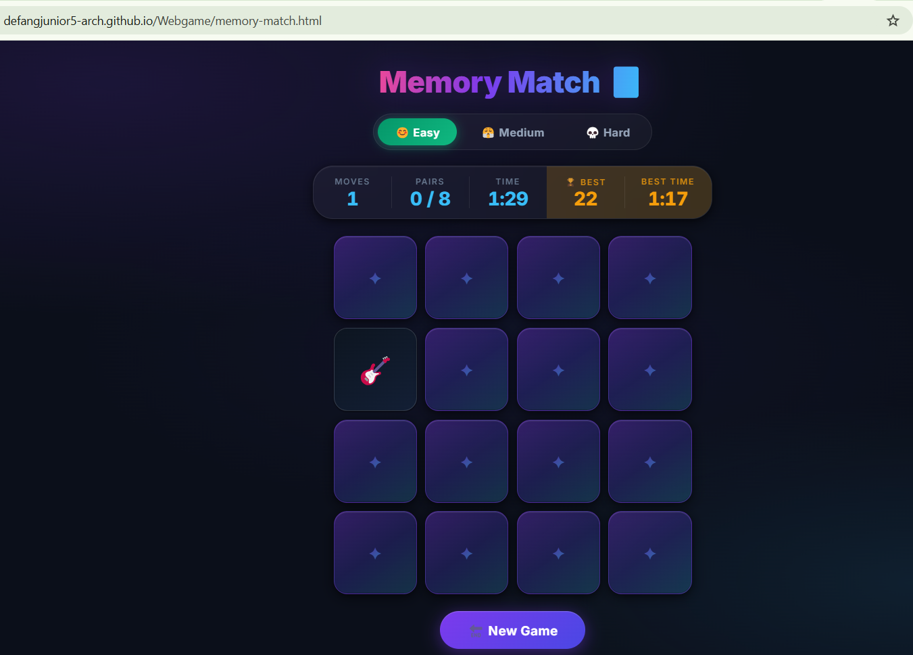
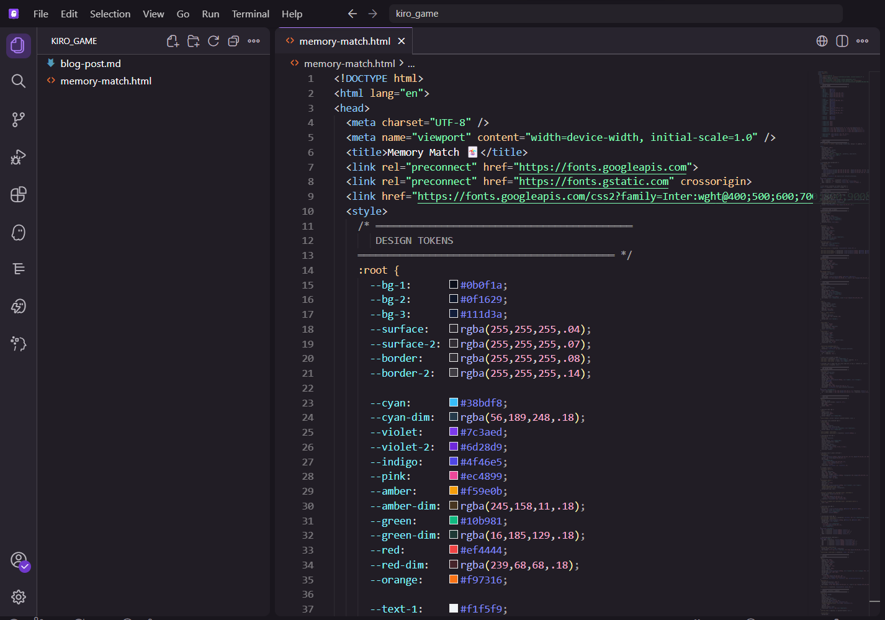
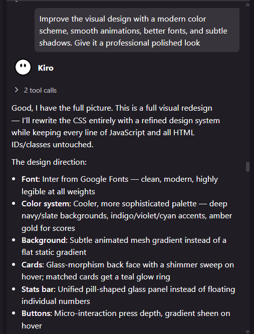
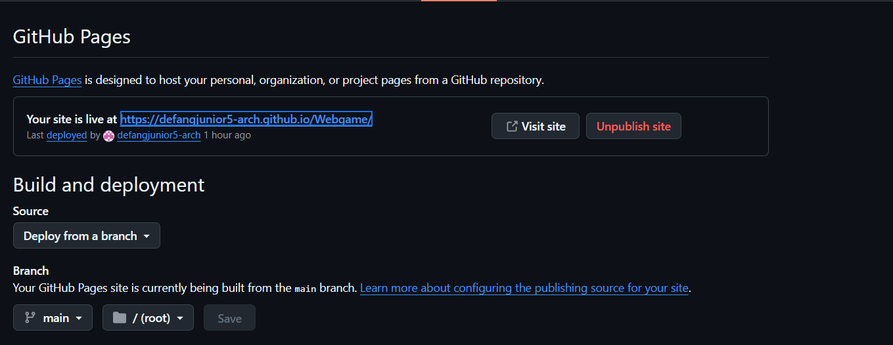

# I Built a Web Game With AI in One Session — Join Us at AWS Student Community Day Buea, 21 November 2026!

> **You are invited.** AWS Student Community Day Buea happens on **21 November 2026** at the University of Buea. Come spend a day building real projects with AI-powered tools alongside fellow students and AWS community mentors. Follow the **AWS Student Builder Group at the University of Buea** for registration details.

---

🎮 **Play It Now:** [https://defangjunior5-arch.github.io/Webgame/memory-match.html](https://defangjunior5-arch.github.io/Webgame/memory-match.html)

💻 **Explore the Source Code:** [https://github.com/defangjunior5-arch/Webgame](https://github.com/defangjunior5-arch/Webgame)

---

## From Zero to a Working Game in One Session

A few weeks before **AWS Student Community Day Buea**, our group ran a series of preparation sessions to get students comfortable with modern developer tools. Pre-Session 4 was all about **Kiro IDE** an AI-powered development environment built on VS Code where an AI agent writes, edits, and reasons about code right alongside you.

The challenge for the session was simple: *start from nothing and build something real*. No starter templates, no copying from tutorials, no prior game-dev experience required. I decided to build a **Memory Match card game** a classic flip-the-cards puzzle that I thought would be achievable in a session but still interesting enough to show off.

What actually happened exceeded my expectations by a significant margin.

---

## What I Built


*Screenshot 1: Memory Match live at defangjunior5-arch.github.io/Webgame/memory-match.html*

The finished game is a **4×4 grid of 16 face-down cards**, each hiding one of eight emoji characters a fox, a frog, a lion, an octopus, a butterfly, a whale, a cherry blossom, and a guitar. You flip two cards per turn; if they match, they stay open with a green glow. If they don't, they flip back and you have to remember where each one was.

But the game grew well beyond the basic idea. By the end of the session it had:

- **Three difficulty levels**  Easy, Medium, and Hard  each changing how fast cards flip and how long unmatched cards stay visible before flipping back. Hard mode adds a **90-second countdown** that turns red and ticks when you hit the last 10 seconds.
- **A live stats panel** showing your move count, pairs found, and time elapsed  all inside a clean glass-effect bar.
- **A persistent high-score system** that saves your best result per difficulty level in the browser so it survives page reloads.
- **Ten synthesised sound effects** card flip, match, no-match, last pair, victory fanfare, countdown tick, timeout, new record, and more all generated live using the Web Audio API with zero audio files to download.
- **A polished start screen** with animated floating preview cards and a step-by-step how-to-play guide.
- **Canvas confetti** that fires on a win.

The entire game is a **single HTML file** 1,366 lines with no frameworks, no build tools, and no server required.

---

## How Kiro IDE Built It With Me


*Screenshot 2: Kiro IDE with the game's CSS design token system visible in the editor*

Here is the honest truth about how the code got written: I described what I wanted, and Kiro wrote it. Then I described what I wanted to change, and Kiro changed it — without breaking anything that was already working. I tested in the browser after each step, gave feedback, and repeated.

The first prompt was the whole game:

> *"Build a Memory Match card game as a single HTML file. Create a 4×4 grid of cards face down. When clicked, cards flip to reveal emojis. If two flipped cards match, they stay face up. If not, they flip back after a moment. Track the number of moves and time. Show a victory message when all pairs are matched. Make it colorful and fun."*

That single sentence produced a complete working game. Cards flipped in 3D, matching logic worked, the victory screen appeared. Then came the layered improvements, one prompt at a time:


*Screenshot 3: Kiro responding to the "professional polished look" prompt, listing every design decision it was about to make*

> *"Add sound effects for when the player scores, when the game ends, and for other important events. Use free web audio APIs so it works without any external files."*

> *"Add a high score system that saves the best score in the browser's local storage, so it persists between sessions."*

> *"Add difficulty levels (Easy, Medium, Hard) that the player can choose before starting. Each level should change the game speed or challenge appropriately."*

> *"Add a start screen with the game title, instructions on how to play, and a Start Game button."*

> *"Improve the visual design with a modern color scheme, smooth animations, better fonts, and subtle shadows. Give it a professional polished look."*

Each prompt targeted exactly one thing. Kiro read the existing code before every edit and never touched what it didn't need to. When I asked for sounds, the card logic stayed untouched. When I asked for a visual redesign, the JavaScript was left entirely alone. That discipline made iteration feel safe  I could always test, see what changed, and move forward confidently.

What I noticed is that Kiro also explained its decisions. When it rewrote the CSS, it told me it was switching to Inter font, building a CSS custom-property design system, adding an animated mesh gradient, and using glass-morphism on the cards. Reading those explanations taught me things I would not have learned from just running code.

---

## Pushing to GitHub and Going Live


*Screenshot 4: GitHub Pages deployed and live from the main branch*

Once the game was finished, publishing it took about five minutes. From the terminal inside Kiro:

```bash
git init
git add memory-match.html
git commit -m "Initial commit: my first web game"
git branch -m main
git remote add origin https://github.com/defangjunior5-arch/Webgame.git
git push -u origin main
```

Then in the GitHub repository settings, under **Pages**, I set the source to the `main` branch and the root folder, clicked Save, and waited about 60 seconds. GitHub Pages deployed the file automatically. Because the game is a single self-contained HTML file, there is nothing to configure — it just works.

The live URL is: **[https://defangjunior5-arch.github.io/Webgame/memory-match.html](https://defangjunior5-arch.github.io/Webgame/memory-match.html)**

---

## Challenges I Actually Hit

**Authenticating the git push.** The `git push` command hung the first time because GitHub requires token-based authentication, not a password. The fix: generate a Personal Access Token in *GitHub Settings → Developer settings → Personal access tokens*, give it `repo` scope, and paste it when Git asks for a password. Once I knew that, it worked first try.

**Vague design prompts produce confident but unpredictable results.** When I asked for a "professional polished look" without more detail, Kiro made strong choices — a dark navy background, a CSS design-token system, glass-morphism cards. Those choices turned out great, but I had no control over the direction until I saw the result. Being more specific upfront ("dark background, Inter font, glass cards with a shimmer effect") would have got there faster. The lesson: more detail in the prompt means fewer surprise revisions.

**The Hard mode countdown sound was too noisy.** The first version fired the same sound as a card flip for every countdown tick, which felt confusing. Describing the problem precisely — "the countdown tick should be a short, distinct square-wave beep, separate from the flip sound" — got an immediate targeted fix in a few seconds.

---

## What I Learned

**Prompts are specifications.** The quality of what Kiro generates matches the clarity of what you ask for. "Make it look nice" and "use a dark navy background with glass-morphism card backs and spring-eased animations" are very different instructions.

**Iteration beats the perfect first attempt.** No single prompt built the whole game. Each one added one feature, I tested it, then moved on. That loop — describe, generate, review, refine — is the actual workflow and it is faster than planning everything upfront.

**Reading generated code is how you learn.** When Kiro added the Web Audio API engine, I read through the oscillators and gain nodes. When it introduced CSS custom properties, I understood why before I moved on. The code is not a black box — it is a worked example.

---

## What's Next

There is plenty left to build: more emoji themes, a 6×6 grid for a harder challenge, a global leaderboard, an offline-capable Progressive Web App version. More importantly — **try it yourself**. Open Kiro IDE, describe something you want to build, and see what comes back. The best way to understand what these tools can do is to use them.

---

## Come Build With Us on 21 November 2026

This session was one of several events leading to **AWS Student Community Day Buea** on **21 November 2026**, organised by the **AWS Student Builder Group at the University of Buea**. The day is focused on making cloud and AI-powered developer tools real and hands-on for students — exactly the kind of session where you go from curious to actually building something.

If reading this made you want to try Kiro IDE yourself, imagine a full day of it with mentors, fellow students, and a community behind you.

**Mark your calendar: 21 November 2026.** We would love to see you there.

---

*Built with Kiro IDE during Pre-Session 4 of the AWS Student Community Day Buea preparation series · AWS Student Builder Group, University of Buea*
